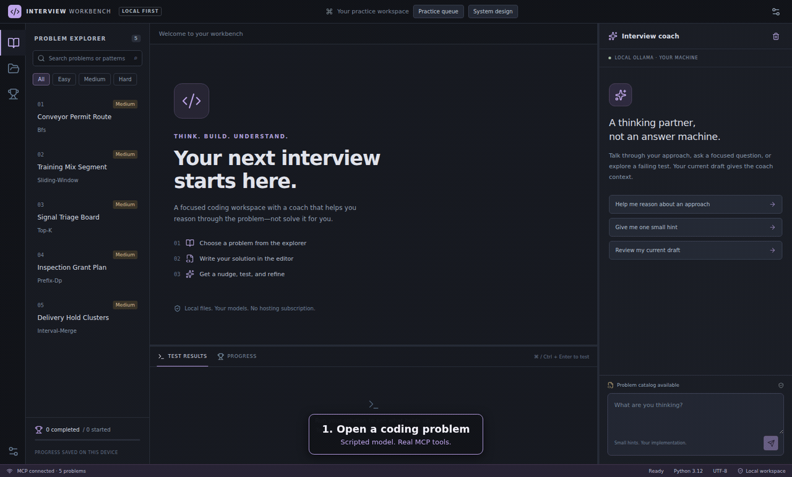
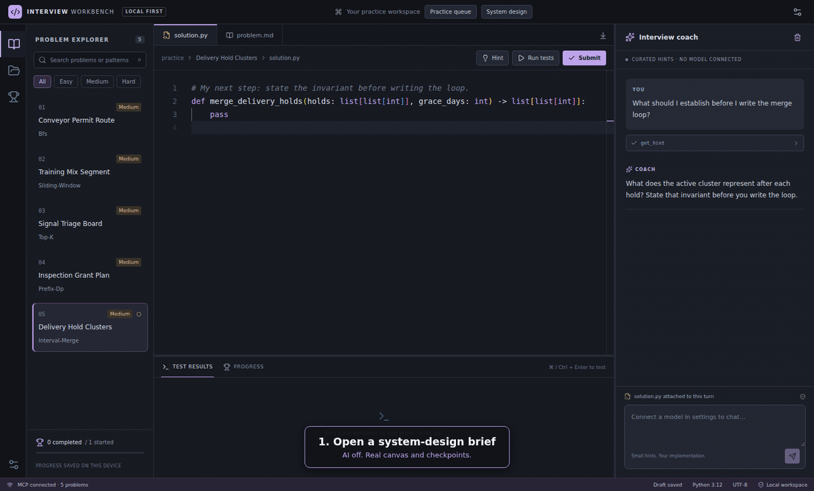
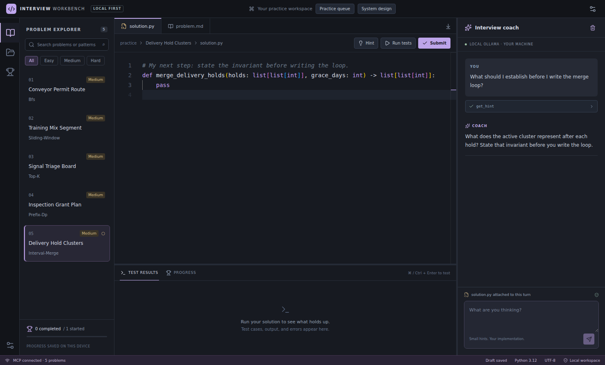
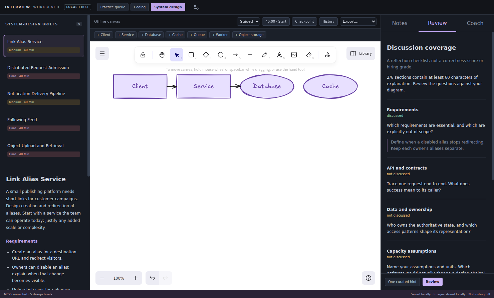
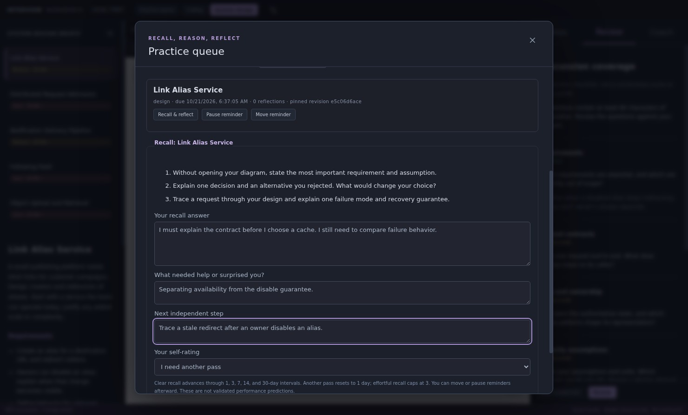

# Interview Workbench

A desktop app for coding and system-design practice, with an optional artificial intelligence (AI) coach.

Write Python code in Monaco. Draw a system design in Excalidraw. Save your work on your computer.
The coach gets hints and test results with Model Context Protocol (MCP) tools.
The app controls which tools the coach can use and which draft each tool receives.

AI is off at first startup. The app keeps the provider that you select.
No model, API key, Docker, or hosting account is necessary for curated hints and system-design practice.

Select **System design** to open the built-in whiteboard. Select **Coding** to return to the editor.
See [MCP server setup](docs/mcp-server.md#vs-code) for VS Code.
See the [public release plan](docs/public-release-plan.md) for accounts, paid packs, deployment, and installers.
Accounts and checkout are proposals, not available app features.

The [Supabase connection test](docs/supabase-hosting.md) is not the complete remote practice engine.
The [term list](docs/terminology.md) gives the meanings of app terms in this guide.

## Agent workflow demo



This recording uses the desktop app and the Python MCP engine.
A scripted local model requests a tool and supplies sample text. No model inference occurs in this demo.
The app executes the MCP tool and keeps the user's draft.
See [the capture guide](docs/media/README.md) for the script and checks.

## The coach workflow

The coach prompt tells the model to give small hints. It tells the model not to supply a full solution.
The app does not let the model change the user's code.

1. The user sends a question with a saved draft.
2. The coach loop sends the question, draft, and permitted tool schemas to the model.
3. The model returns a response or a tool request.
4. The app examines the tool request and supplies the correct attempt ID and draft.
5. The Python MCP engine executes the tool. The coach loop returns the result to the model.
6. The app displays the response and tool activity. The user selects the next action.

For system design, the app captures an immutable checkpoint before each coach turn.
The coach reads that checkpoint, not canvas edits after the request.
It receives notes and diagram labels. It does not receive image files.

The workflow has these limits:

- A turn can request one hint. Hint depth can increase by one, to a maximum of three.
- Coding tools receive the user's saved draft. The model cannot replace the code or select a different attempt.
- User approval is mandatory for a submission. The model cannot finish a system-design session.
- The coach cannot use a shell, edit files, change reminders, or redraw the canvas.
- The loop stops after six model requests or ten tool requests. The user can stop a turn.
- Tool errors return to the model as errors. Large tool previews identify missing evidence.

The prompt does not control access. The desktop service controls tool permissions.

The [coach loop](apps/desktop/src/main/agent.ts) handles model responses and tool requests.
The [desktop service](apps/desktop/src/main/service.ts) supplies the saved draft and controls tool permissions.
The [provider adapters](apps/desktop/src/main/providers.ts) support Ollama and the Claude API.
The [Python backend](server/main.py) supplies the MCP tools.

## Offline system-design demo



The canvas, fonts, notes, and image assets stay local.
Use guided mode for curated hints. Use mock mode for practice without hint controls.
Save checkpoints, restore saved work, or export the canvas as PNG or an Excalidraw file.
A design review shows discussion coverage. It does not show that a design is correct.

## Screenshots

### Coding workspace



### System-design workspace



### Recall and reflection



The user adds reminders and records self-ratings. The coach cannot change these records.
Each saved reflection keeps its history. A self-rating is not a test result.

## Start locally

### Requirements

- [Git](https://git-scm.com/downloads).
- [Node.js 24](https://nodejs.org/en/download).
- [uv](https://docs.astral.sh/uv/getting-started/installation/) for Python dependencies.
- Python 3.12. uv can download this version when necessary.
- A graphical desktop. The Electron system libraries are necessary for Linux.

Docker and an AI model are optional. Do not install them for your first session.

### Start the desktop app

Enter these commands in a terminal or Windows PowerShell.

```bash
git clone https://github.com/ArmandSyah/interview-mcp.git
cd interview-mcp
uv sync --frozen --dev --python 3.12
cd apps/desktop
npm ci
npm run install:electron
npm run dev
```

The app starts a local Python MCP process. A different server and an `.env` file are not necessary.
The initial catalog contains five coding examples and five system-design briefs.

For a first check:

1. Open a coding problem.
2. Select **Hint** to get a curated hint.
3. Select **System design**.
4. Open a brief.
5. Add a component and enter a note.
6. Select **Checkpoint** to save the evidence.
7. Select **Review** to see discussion coverage.

Close the app to stop the development process. Drafts stay in the local app data directory.

If `libnss3` and `libasound2t64` are not installed on Ubuntu 24.04, install them.
GTK and X11 libraries are also necessary for Linux. WSLg is necessary for an app window in WSL.
See [desktop setup and troubleshooting](apps/desktop/README.md) for details.

### Enable the AI coach

Open **Settings**. Select a provider in the **AI coach** section.

- **Off:** use curated hints without a model.
- **Ollama:** use a model that you install and start locally.
- **Claude API:** enter your Anthropic API key. Each chat uses your API account.

A paid provider receives the message and applicable practice text when you send a chat.
The app does not make background model calls. It does not install a model automatically.

### Enable code execution

The editor does not execute code on your host Python.
Code tests use a local Piston container.

1. Install Docker with Compose.
2. Start Docker.
3. Open **Settings** in the app.
4. Select **Check local sandbox**.
5. Read the privileged-container warning.
6. Select **Enable local execution** only on a trusted workstation.

Setup downloads the container image and Python runtime.
Linux AMD64 containers and cgroup v2 are necessary for the bundled image.
The app does not manage remote Docker endpoints.
See [the sandbox guide](apps/desktop/README.md#enable-code-execution) for manual setup and shutdown commands.

## Prepare desktop packages

After the local setup, enter these commands from `apps/desktop`:

```bash
npm run backend
npm run build
npm test
npm run test:desktop
npm run dist -- --publish never
```

`npm run backend` bundles Python and the MCP engine with PyInstaller.
`npm run dist` creates an installer for the host operating system in `apps/desktop/release`.
Use `npm run package` to create an unpacked app as an alternative.
Packaged apps include the public examples. Node.js, uv, and the source checkout are not necessary to start them.

A graphical display is necessary for native UI tests.
Linux and Windows have build workflows. The installers are unsigned development builds, not a trusted public release.

## Architecture and checks

| Component | Responsibility |
| --- | --- |
| Electron main process | Connect to MCP, operate the coach loop, control permissions, and save local files. |
| React desktop UI | Display the editor, canvas, notes, tool activity, and practice queue. |
| Python MCP engine | Supply practice tools and store owned attempts, checkpoints, and reflections. |
| SQLAlchemy and SQLite | Keep local records and the content revision for each attempt. |
| Piston | Execute submitted Python code in the optional local container. |

The renderer has no Node.js access. An IPC interface connects it to the main process.

The main process stores API keys. Snapshots and the Python process do not receive them.
The app uses OS secure storage when available.
Without secure storage, keys stay in memory until exit. Practice text is not encrypted.

Do the Python checks from the repository root:

```bash
uv run ruff check server tests tools
uv run ruff format --check server tests tools
uv run mypy server tools
uv run pytest -q
```

Do the desktop checks from `apps/desktop`:

```bash
npm run format:check
npm run typecheck
npm test
npm run test:desktop
```

Tests include model tool requests, forged IDs, saved draft selection, one-hint limits, cancellation, and submission approval.
Native tests include coding, design checkpoints, image exports, saved work, and recall.
Model tests use local fixtures. They do not make paid API calls.
Docker tests start only with an explicit opt-in. See [the desktop test guide](apps/desktop/README.md#build-and-check).

## Project status

This is a development project. It does not give a validated interview grade.
The public catalog is small. There is no hosted service or checkout.
Production trust keys, signed releases, and an archive restore UI are not configured.

See [the desktop guide](apps/desktop/README.md), [MCP server setup](docs/mcp-server.md), and [demo capture](docs/media/README.md).
The project uses the [Apache 2.0 license](LICENSE). Bundled dependencies include their notices.
